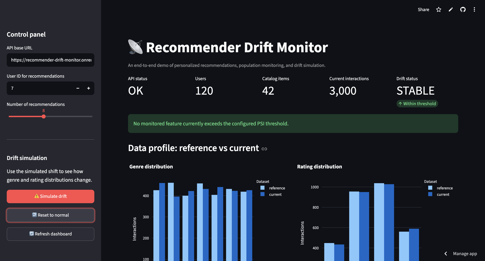
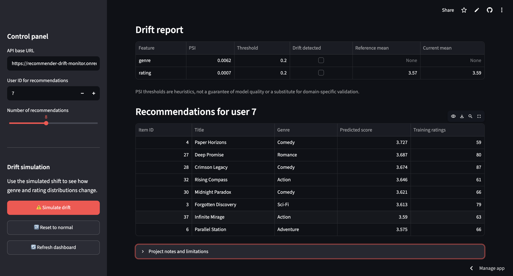
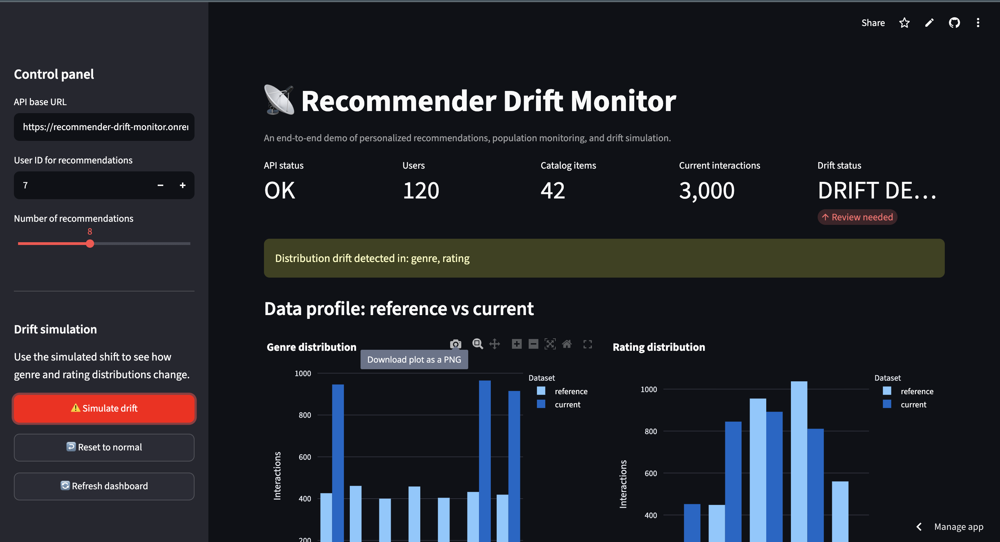
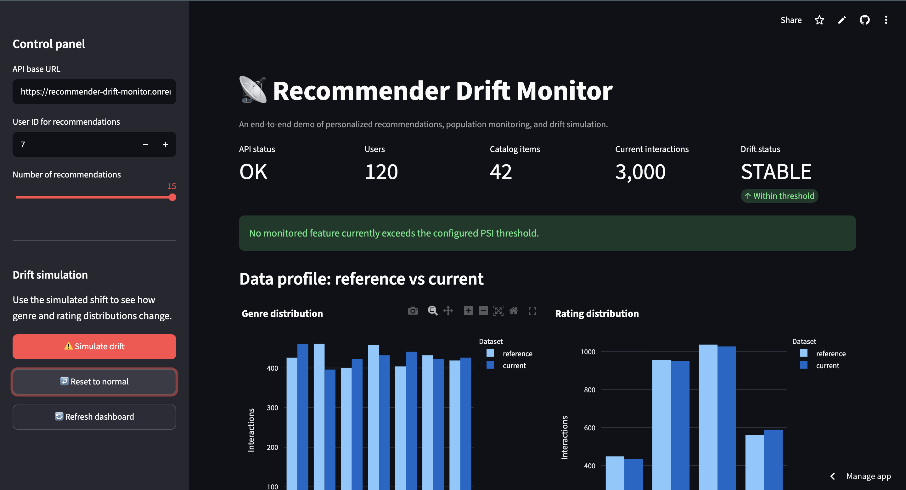

# Recommender Drift Monitor

An end-to-end machine-learning engineering portfolio project that combines an item-item recommendation engine, data-drift monitoring, a FastAPI service, and a Streamlit dashboard.

> **Demo data notice:** All users, items, ratings, and timestamps are generated synthetic data. This project is a technical demonstration, not a production recommender or a validated alerting system.

## Live Demo

- **Interactive Streamlit dashboard:** https://recommender-drift-monitor-kfzgmsbytzkiuqsr2vuqyb.streamlit.app
- **FastAPI backend:** https://recommender-drift-monitor.onrender.com
- **API documentation:** https://recommender-drift-monitor.onrender.com/docs
- **Health check:** https://recommender-drift-monitor.onrender.com/health

The dashboard uses synthetic demonstration data. Render's free backend
may take a short time to wake after inactivity.

## Features

- Item-item collaborative filtering with cosine similarity over a user-item rating matrix.
- Personalized recommendations that exclude items already rated by a known user.
- Cold-start fallback recommendations for users not present in the training window.
- Population Stability Index (PSI) checks for rating and genre distributions.
- A controllable drift simulation and reset endpoint.
- FastAPI endpoints with generated OpenAPI documentation.
- Streamlit dashboard with distribution comparisons, drift status, a drift report, and recommendations.
- Deterministic synthetic fixtures, automated tests, Ruff linting, and GitHub Actions CI.
- No API keys or paid services required.

## Architecture

```text
Synthetic reference + current interaction windows
                |                         |
                v                         v
     Item-item recommender           PSI drift monitor
                |                         |
                +------------+------------+
                             v
                     FastAPI service
                             |
                             v
                    Streamlit dashboard
```

## Quick start on macOS or Linux

Python 3.11 or newer is recommended. Python 3.13 should work with current compatible package wheels.

```bash
cd ~/Projects/recommender-drift-monitor
chmod +x bootstrap.sh run_local.sh
./bootstrap.sh
./run_local.sh
```

The setup script creates `.venv`, installs dependencies, runs Ruff, and runs all tests. The launcher starts the API and dashboard together. Press `Ctrl+C` in the terminal to stop them.

- Dashboard: `http://localhost:8501`
- API health: `http://127.0.0.1:8000/health`
- API interactive docs: `http://127.0.0.1:8000/docs`
- Drift report: `http://127.0.0.1:8000/drift/report`
- Overview data: `http://127.0.0.1:8000/overview`

## API examples

Get recommendations for user 7:

```bash
curl "http://127.0.0.1:8000/recommend/7?limit=8"
```

Simulate an incoming distribution shift:

```bash
curl -X POST "http://127.0.0.1:8000/drift/simulate" \
  -H "Content-Type: application/json" \
  -d '{"shifted": true}'
```

Reset the current window to normal synthetic data:

```bash
curl -X POST "http://127.0.0.1:8000/drift/reset"
```

## Run checks manually

```bash
source .venv/bin/activate
python -m ruff check .
python -m pytest -q
```

## How the model works

1. Synthetic user-item ratings are pivoted into a matrix.
2. Each user's observed ratings are centered around their mean.
3. Cosine similarity compares item rating vectors.
4. Recommendations score unseen items using similarities to the user's known ratings, with a rating-popularity fallback.

The project is intentionally compact and explainable. It is not intended to replace a ranking system evaluated with offline and online metrics.

## How drift monitoring works

The monitor compares reference and current-window distributions for:

- `genre`: the item genres represented in interactions.
- `rating`: the distribution of recorded ratings.

The Population Stability Index is used as a heuristic indicator. The default threshold is `0.20`; that convention is not a universal statistical guarantee. Production use should include context-specific threshold calibration, sample-size checks, data quality checks, ranking-quality metrics, and monitoring of business outcomes.

## Repository layout

```text
.
├── .github/workflows/ci.yml
├── src/recommender_drift_monitor/
│   ├── api.py
│   ├── data.py
│   ├── monitor.py
│   ├── recommender.py
│   └── service.py
├── tests/
├── dashboard.py
├── bootstrap.sh
├── run_local.sh
├── requirements.txt
├── requirements-dev.txt
└── pyproject.toml
```

## License

MIT. See [LICENSE](LICENSE).

## Screenshots

### Dashboard Overview


### Personalized Recommendations


### Drift Detection


### Reset to Normal


